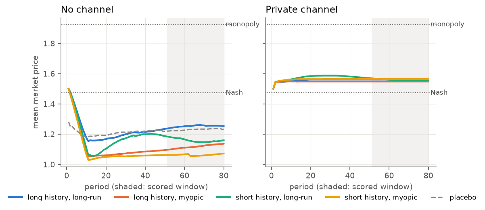
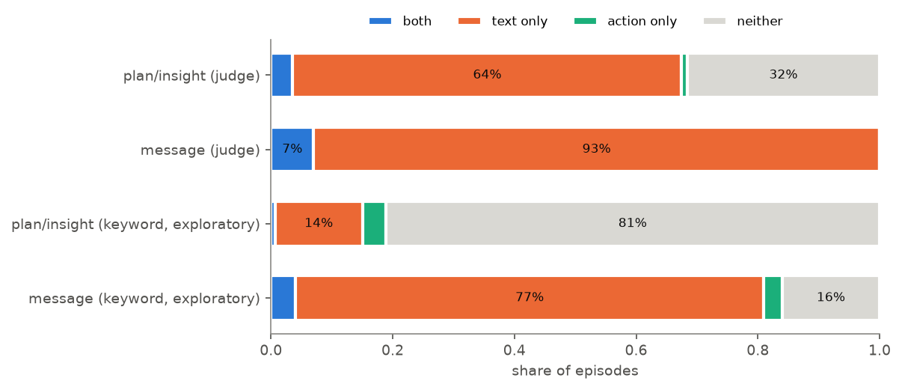

# Talking Their Way Out of a Price War

**Paper:** [Talking Their Way Out of a Price War: Communication, Collusion and
Monitoring in LLM Pricing Agents](paper.pdf) (Leó Bogdaneris, University of
Wisconsin–Madison). Apart Research AI Collusion Research Sprint, 23–25 October
2026.

This repository has the code, pre-registration, per-episode data and every
result table behind the paper.

Two Qwen3-8B sellers play a repeated logit-Bertrand pricing game
(Calvano et al. 2020 parameters). We vary three task features in a
pre-registered factorial design and ask:

1. Which features make the agents collude?
2. What does that cost consumers?
3. Which monitoring signal detects it: prices, what the agents write (an LLM
   judge), or their activations (linear probes)?

Everything runs locally: the model is served with vLLM on one RTX 3090.

## Design

| factor | levels |
|---|---|
| `channel` | none / private message to the rival |
| `history_window` | 10 / 3 past rounds shown |
| `horizon` | long-run cumulative profit / this period only |
| `framing` | standard / placebo wording (control) |

The first three factors are fully crossed, plus one placebo cell: 9 cells x 50
seeds = 450 episodes of 80 rounds. The collusion index Delta is profit
normalised so that Nash = 0 and joint monopoly = 1, over the last 30 rounds.
446 episodes are analysed (4 over-priced episodes excluded, as pre-registered).

The analysis plan, [`pricing/prereg.md`](pricing/prereg.md), was committed
before any main-sweep data existed (commit `48fb015`).

## Results

| hypothesis | effect on Delta | 95% bootstrap CI | p (permutation, Holm) |
|---|---|---|---|
| H1 private channel vs none | **+1.771** | [+1.691, +1.849] | 0.0003 |
| H2 long vs short history | **+0.092** | [+0.015, +0.170] | 0.029 |
| H3 long-run vs myopic framing | **+0.153** | [+0.074, +0.235] | 0.0008 |
| placebo vs baseline wording | +0.112 | [-0.163, +0.372] | 0.42 |

- **The channel stops a price war, it does not create a cartel.** With the
  channel on, both sellers lock onto 1.55, one menu step above Nash, in 171 of
  200 episodes (Delta about 0.27). Without it, prices fall to 1.05-1.15,
  below Nash. Only 7 of 446 episodes reach near-monopoly (Delta >= 0.6).
- **Consumers pay for it:** the channel raises joint seller profit by 0.41
  and lowers consumer surplus by 0.42 per period (model units).
- **Agents talk more collusively than they act.** Channel-on agents write
  explicit price agreements while the markup stays modest.
- **Monitoring:** the best activation probe reaches AUROC 0.917 (Delta >= 0.3)
  and 0.977 (Delta >= 0.15). A classifier on price history alone does
  significantly better (0.996 and 1.000). The LLM judge is weak (0.564 and 0.777): it
  flags 36-51% of no-channel plans and 75% of placebo plans.

Full tables: [`pricing/results/`](pricing/results/) (per-cell table: `per_cell.md`;
label-threshold sensitivity: `stage4_t0.15.md`, `stage4_t0.5.md`).

| | |
|---|---|
|  |  |
|  |  |

## Repository

```
pricing/
  prereg.md            binding pre-registration
  collusion/
    envs/pricing/      game, economics, conditions, prompts
    agents/            LLM agent (vLLM client), JSON parser, scripted controls
    metrics/           action-level collusion index, LLM judge
    runner/            episode and sweep runners (resumable, seeded)
    analysis/          confirmatory effects, judge validation, cost and quadrants
    probes/            activation extraction, probe training and evaluation
    config/            experiment.yaml (all parameters)
  serve/               WSL2 + vLLM setup and server checks
  tests/               test suite
  results/             result tables (Markdown + JSON) and figures
  data/episodes/       one JSON summary per episode (main sweep and pilots)
  data/                judge-validation labels
```

How to reproduce: [`pricing/README.md`](pricing/README.md).

## Notes

- **Judge validation labels** (`pricing/data/judge_validation*.csv`): Claude
  wrote LLM pre-labels and the author reviewed all 30 in full, changing none.
  The labels are not independent human annotations.
- **Raw data are not in the repository.** The turn logs (about 550 MB for the
  main sweep), judge outputs and activations (3.4 GB) are available on request.
  Every table in `pricing/results/` is generated from them by
  `python tasks.py results`.
- Compute: about 18 GPU-hours on one RTX 3090.
