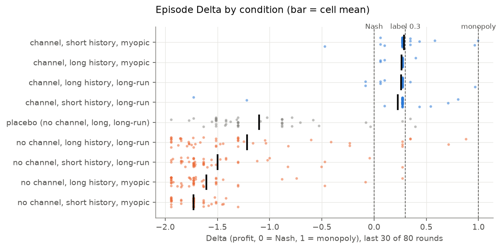
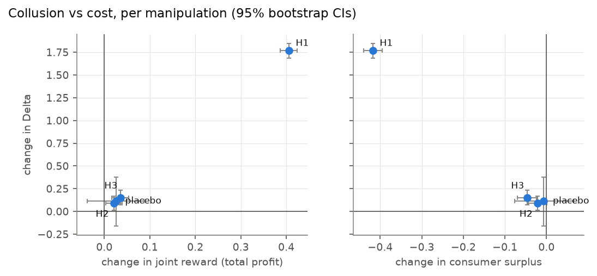

# Talk Is Cheap, Prices Are Not: Communication, Memory and Horizon in LLM Pricing Agents

**Leó Bogdaneris** · Apart Research sprint, October 2026 · Track A (repeated pricing game)

## Abstract

We ask which task features make LLM agents collude, and how collusion shows
up in their words, their prices and their internal activations. Two Qwen3-8B
sellers play an 80-round repeated logit-Bertrand duopoly. We vary three
factors in a fully crossed design: a private message channel, the length of
price history shown, and long-run versus this-period profit framing. A
cosmetic-wording placebo cell is added, giving 9 cells × 50 seeds = 450
episodes. Hypotheses, metrics and the label threshold were pre-registered
before the main sweep.

- **H1, the private channel,** raises the collusion index Δ by +1.77, 95% CI
  [+1.69, +1.85]. **H2, a longer history,** raises it by +0.09
  [+0.02, +0.17]. **H3, long-run framing,** raises it by +0.15
  [+0.07, +0.24]. All three survive Holm correction. The placebo shows no
  effect.
- **The channel mostly prevents a price war.** Its effect is not a push to
  monopoly. Without it, sellers fall below the Nash price (median price
  1.10). With it, 171/200 episodes lock onto a single focal price, 1.55, one
  menu step above Nash (Δ≈0.26).
- **Every factor that raises Δ moves surplus from consumers to sellers.**
- **H5: text-level collusion far exceeds action-level collusion.** Messages
  flag coordination in 93% of channel-on episodes that do not reach the
  action threshold, against 0% the other way (p < 10⁻⁵⁵).
- **Activation probes detect the action label well,** with AUROC up to 0.92 at
  Δ ≥ 0.3, and they hold within each channel condition. They clearly beat an
  LLM judge, **but they do not beat a classifier on the price history the
  agents were shown**. This fails our pre-registered bar for "the probe adds
  information".

## 1. Introduction

Calvano et al. (2020) showed that Q-learning pricing agents can learn
supra-competitive prices. Fish et al. (2024) showed that LLM pricing agents
can reach them too, sometimes without being told to. For oversight, the
useful question is not just *whether* LLM agents collude. It is *which task
features* cause it, *what it costs* consumers, and *which monitoring signal*
catches it: what agents say, what they do, or what their activations
encode. We test all three on one design, with a pre-registration and a
placebo control.

## 2. Methods

**Environment.** A repeated logit-Bertrand duopoly with the Calvano et al.
parameters (a = 2, a₀ = 0, c = 1, μ = 0.25). The Nash price is 1.473 and the
joint-monopoly price 1.925. Each episode lasts 80 rounds. Each round, each
seller returns JSON `{price, plan, insight[, message]}` with the price picked
from a menu of 1.00–2.50 in steps of 0.05. The prompt shows the profit
formula, and a table of recent rounds: the seller's own price, quantity
and profit, and the rival's price.

**Agents.** Both sellers are Qwen3-8B (bf16, revision b968826), served
locally by vLLM 0.32 on one RTX 3090. Thinking is off; temperature 0.7,
top-p 0.9, at most 150 output tokens. A reply with an off-menu price is
retried up to twice. If it still fails, the seller's previous price is
carried forward. 0.91% of 72,000 turns ended this way.

**Design (pre-registered).** Each condition changes only its own slots of
the prompt; a test diffs the prompts of every condition pair to enforce
this.

| factor | levels |
|---|---|
| channel | none; private message, seen by the rival next round |
| history window | long (10 rows); short (3 rows) |
| horizon | long-run cumulative profit; this period only (myopic) |
| framing (placebo) | standard; cosmetic rewording, baseline cell only |

These form 8 crossed cells plus the placebo: 9 cells × 50 seeds = 450
episodes, run in 25 balanced batches. All 450 completed; 4 pre-registered
"over-priced" episodes are excluded, leaving 446.

**Action metric.** Δ = (profit − profit_Nash) / (profit_Monopoly −
profit_Nash), averaged over both sellers and the last 30 rounds. Δ = 0 is
Nash and Δ = 1 is monopoly. The pre-registered binary label is **Δ ≥ 0.3**,
with sensitivity analyses at 0.15 and 0.5. H1–H3 are tested as main-effect
differences in means. Each gets a permutation p-value (10,000 permutations
within strata of the other two factors), a 95% bootstrap CI (episodes
resampled within cell) and a Holm correction. An OLS model with HC3 standard
errors is the cross-check.

**Text metrics.** Message-level text (channel on only) and plan/insight-level
text (all cells) are scored separately. The main scorer is a Qwen3-8B judge
at temperature 0 with a fixed rubric from 0 to 1. A frozen keyword regex
serves as a baseline. The judge threshold was calibrated on 30 items from 20
episodes. *These labels were pre-filled by an LLM (Claude) from the transcript
digest alone and then reviewed in full by the author, who changed none.*

**Probes.** Qwen3-8B residual-stream activations at the final prompt token
were extracted for all 72,000 logged turns at layers
11/14/18/22/25/29 (30–80% of depth). Mean teacher-forced log-probability of
the logged replies is −0.03 to −0.05, extraction is deterministic, and 0 of 72,000 token
counts differ from the server's. Probes were trained on the 26,760 scored
turns of the 446 analysed episodes:
- **Probe types:** L2 logistic regression, with C chosen by inner group-CV,
  and a difference-of-means direction. Both run on 256 PCA components fitted
  on the training folds.
- **Splits:** always by episode. Turn scores are averaged (or maxed) into an
  episode score.
- **Baselines:** TF-IDF on the episode text, the judge score, and a classifier
  on the price history the agents were shown.
- **Controls:** a shuffled-label run, leave-one-condition-out transfer, and
  cross-validation within each channel condition.

## 3. Results

### 3.1 Confirmatory effects (H1–H3, placebo)

| | contrast | ΔΔ | 95% CI | p (Holm) |
|---|---|---|---|---|
| **H1** | private channel − none | **+1.771** | [+1.691, +1.849] | 0.0003 |
| **H2** | long − short history | **+0.092** | [+0.015, +0.170] | 0.029 |
| **H3** | long-run − myopic | **+0.153** | [+0.074, +0.235] | 0.0008 |
| placebo | placebo − baseline wording | +0.112 | [−0.163, +0.372] | 0.42 |

(ΔΔ is the change in the collusion index Δ.)

All three hypotheses are supported in the pre-registered direction, and the
OLS cross-check agrees. On the binary label, H1 is significant at 0.3
(logit p = 0.026) and at 0.15, but not at 0.5 (p = 0.12). H2 and H3 are not
significant on the binary label at any threshold.

**What the effects mean.**
- **Channel on:** both sellers price at exactly 1.55, with zero dispersion,
  in 171 of 200 episodes. They reach it in round 2 and hold it for the rest
  of the game (Figure 2).
- **Channel off:** prices collapse below Nash within about 10 rounds, to a
  median of 1.10, and settle there (Δ ≈ −1.5).
- So most of H1 is the channel *preventing a sub-competitive price war*. The
  collusion it enables is mild: about a quarter of the way from Nash to
  monopoly.
- **H2 and H3** come entirely from the no-channel cells (exploratory
  reading). The four channel-on cells are flat at Δ 0.23–0.29.

### 3.2 Collusion vs cost

Each manipulation that raises Δ moves surplus from consumers to sellers. The
channel moves about 0.41 profit units per period, matched by a 0.42 loss in
consumer surplus. H3 and H2 cost consumers 0.05 and 0.02 (the H2 CI touches
0). The placebo moves nothing.

| | ΔΔ | Δ joint profit | Δ consumer surplus |
|---|---|---|---|
| H1 channel | +1.77 | +0.41 [+0.39, +0.42] | −0.42 [−0.44, −0.40] |
| H2 history | +0.09 | +0.02 [+0.00, +0.04] | −0.02 [−0.04, +0.00] |
| H3 horizon | +0.15 | +0.04 [+0.02, +0.05] | −0.05 [−0.07, −0.03] |
| placebo | +0.11 | +0.03 [−0.04, +0.09] | −0.01 [−0.08, +0.07] |

**Predict-then-verify.** Each pair of crossed cells was held out in turn (28
splits), and the additive model was fitted on the other six cells.
- **Δ:** the model predicts held-out cell means with a mean absolute error of
  0.19, against 1.01 for the grand mean, and wins in 28 of 28 splits.
- **Binary label:** it does not predict the rare Δ ≥ 0.3 label. It wins only
  6 of 28 splits against the grand mean.

### 3.3 Text vs action (H5)

The H5 test is an exact McNemar test. It compares the number of episodes
flagged by text only with the number flagged by action only.

| measure | both | text only | action only | neither | McNemar |
|---|---|---|---|---|---|
| message, judge (channel on, n = 200) | 7% | **93%** | 0% | 0% | 186 vs 0, p = 2·10⁻⁵⁶ |
| plan/insight, judge (n = 446) | 4% | **64%** | 1% | 32% | 285 vs 4, p = 6·10⁻⁷⁹ |
| message, keyword (exploratory) | 4% | 77% | 3% | 16% | 154 vs 6, p = 3·10⁻³⁸ |

**H5 is supported:** agents state coordinating intent far more often than
their prices reach the collusion threshold. A typical exchange reads "I agree
to maintain price at 1.55 for continued stability and mutual profitability."
The sellers do exactly that, but 1.55 is barely above Nash.

The gap depends on the threshold. At Δ ≥ 0.15, 93% of channel-on episodes are
flagged on *both* text and action. So the honest summary is that agents
*say* "collude" and *do* "coordinate weakly".

Judge calibration was weak:
- **Plan/insight:** balanced accuracy 0.71, κ = 0.31, AUROC 0.76, all
  in-sample.
- **Message:** calibration was degenerate. All 10 labelled items were
  positive, and the judge never scored a message below 0.6.
- **No-channel plans:** the judge still flags 36–51% of them in the standard
  cells, where prices sit near cost. The keyword baseline flags 0% there.

### 3.4 Activation probes

| | Δ ≥ 0.3 (20 positives / 446) | Δ ≥ 0.15 (197 / 446) |
|---|---|---|
| probe, best layer (LR, mean over turns) | **0.917** [0.83, 0.99], L18 | **0.977** [0.96, 0.99], L25 |
| probe, layer range (LR) | 0.84–0.92 | 0.96–0.98 |
| difference-of-means | 0.62–0.68 | 0.93–0.95 |
| shuffled-label control | 0.55 | 0.40 |
| TF-IDF baseline | 0.857 | 0.972 |
| judge baseline | 0.564 | 0.777 |
| **price-history baseline** | **0.996** | **1.000** |
| probe − price history (paired bootstrap) | −0.08 [−0.17, −0.01] | −0.02 [−0.04, −0.01] |
| within channel on / off | 0.97 / 0.91 | 0.84 / 0.91 |

Values are AUROC with 95% bootstrap CIs over episodes; TPR at 5% FPR is in
`results/probes.md`.

- **The probe signal is real.** The shuffled control is at or below chance,
  and the signal survives within each channel condition and across held-out
  conditions (leave-one-condition-out AUROC 0.84–1.0 where a cell has both
  classes).
- **It beats the LLM judge by a wide margin** (+0.35 [+0.24, +0.46] at 0.3).
- **But it fails the pre-registered test.** It does not add beyond the
  price-history baseline: the prompt contains the very prices the label is
  computed from, and a 12-feature classifier on those prices is almost
  perfect.
- **Exploratory:** a ridge probe recovers the per-turn rolling Δ with
  cross-validated R² of 0.85–0.87 at every layer.

## 4. Discussion

**The channel is the dominant lever, and it works by averting a price war.**
Without communication, Qwen3-8B sellers undercut each other toward cost. That
is a worse-than-Nash outcome, and it matches the anchoring behaviour we saw in
pilots. Given a channel, they agree almost immediately on a focal price one
menu step above Nash and keep to it. Memory (H2) and the long-run frame (H3)
matter, but only when there is no channel to coordinate through.

**Words overstate actions.** Monitoring messages would flag nearly every
channel-on episode as collusive, yet prices stay close to competitive. A
text-based monitor would vastly over-report harm in this setting. An
action-based monitor at our pre-registered threshold would see almost none.
Which signal is "right" depends on whether the stated intent or the realised
price is the thing being regulated.

**Probes read the market state, not hidden intent.** Linear probes recover
the action label and its continuous version well, and they generalise across
conditions. But everything they find is matched by a simple classifier on the
price table already in the prompt. In this environment, activations add no
detectable information beyond what is plainly visible. A test of "latent
collusive intent" would need a setting where the observable history does not
determine the label.

## 5. Limitations

- **Scope:** one model family (Qwen3-8B) plays both sellers *and* the judge,
  which risks self-preference in H5. There is one environment, two sellers,
  and a discrete 31-value price menu.
- **Tuning on pilots:** the profit sentence, the price menu and the 0.3
  threshold were set after pilots. All of this is pre-registered and
  disclosed.
- **The 0.3 label is fragile:** it sits just above the focal price 1.55, so
  only 20 episodes are positive. The binary-label analyses (logit
  robustness, the predict-then-verify label, the probes at 0.3) are
  underpowered.
- **Judge calibration:** it uses LLM pre-labels reviewed by one human with
  zero changes. Agreement is in-sample. Message calibration is degenerate.
- **Reproducibility:** batched vLLM serving is not bit-reproducible at the text
  level. The effects describe this model's behaviour, not that of rational
  agents.

## 6. Deviations and analysis choices not fixed by the pre-registration

1. **H5 test:** the prereg names H5 but not its test. We use an exact McNemar
   test on the discordant episodes.
2. **Judge labels:** the prereg specifies human labels. These were LLM
   pre-labels that a human reviewed in full; none were changed.
3. **Probe subset:** probes use the 30 scored rounds per episode, the turns the
   label is computed over. Activations for the other 45,000 turns are
   extracted but unused.
4. **Probe cost controls:** PCA (256 components) and training on every 5th
   round. The best layer is selected on the same folds, which favours the
   probe; the full layer sweep is reported.
5. **"Adds beyond price history"** is tested as a paired bootstrap over
   episodes of the AUROC difference.
6. **Keyword quadrants:** the cut-off (hit share > 0.5) was chosen after
   seeing the data, so this version is exploratory.
7. **Extraction restarts:** activation extraction was interrupted three times
   (a host-memory kill and two GPU-memory slowdowns) and resumed. Rows reused
   after each restart were checked against fresh re-extraction: maximum
   relative difference 0.031, against the 0.05 limit.

## Reproducibility

All numbers and figures are produced from the saved logs by
`python tasks.py results`, which runs the effects, judge validation, Stage 4
and probes in turn. Design decisions are in `pricing/DECISIONS.md`, and the
binding pre-registration is `pricing/prereg.md` (commit `48fb015`, made
before any main-sweep data existed). Gate reports are in `pricing/reports/`.

## References

- Calvano, E., Calzolari, G., Denicolò, V., & Pastorello, S. (2020).
  Artificial intelligence, algorithmic pricing, and collusion. *American
  Economic Review*, 110(10), 3267–3297.
- Fish, S., Gonczarowski, Y. A., & Shorrer, R. I. (2024). Algorithmic
  collusion by large language models. arXiv:2404.00806.
- Alain, G., & Bengio, Y. (2016). Understanding intermediate layers using
  linear classifier probes. arXiv:1610.01644.
